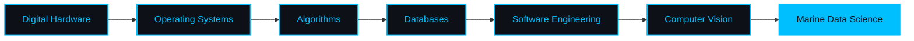
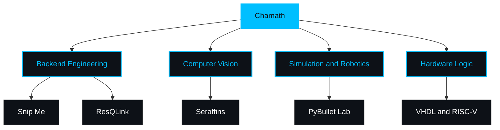

<!-- ═════════════ CAPSULE RENDER HEADER ═════════════ -->

  

<h1 align="center">Hi! I'm M. D. S. Chamath Jayasinghe</h1>

<h3 align="center">
  
</h3>

  <em>I am a Computer Science and Engineering undergraduate building robust backend architectures, training computer vision models, and experimenting with hardware logic.</em>

   <b>Current Focus:</b> Computer Science Engineering & Engineering Mathematics 
   <b>Primary Tech Domains:</b> Computer Vision, Backend Engineering, Hardware Logic 
   <b>LinkedIn:</b> <a href="https://www.linkedin.com/in/mdscj">linkedin.com/in/mdscj</a> 
   <b>Telegram:</b> <a href="https://t.me/ChamathJayasingha">@ChamathJayasingha</a>

##  Technical Arsenal

<!-- Quick view: Skill Icons -->

  

<b>Full technical arsenal (click to expand)</b>

###  Languages
          -1C1C1C?style=for-the-badge)

###  Computer Vision & AI
    

###  Frontend, Backend & Databases
      

###  Hardware, OS & Tools
        

###  Design & Prototyping
  

##  GitHub Activity

  <picture>
    <source media="(prefers-color-scheme: dark)" srcset="https://streak-stats.demolab.com/?user=MDSCJ&theme=dark&hide_border=true" />
    <source media="(prefers-color-scheme: light)" srcset="https://streak-stats.demolab.com/?user=MDSCJ&theme=default&hide_border=true" />
    
  </picture>

<b>Contribution activity graph (click to expand)</b>

 

  

<!-- Contribution snake (needs the GitHub Action in .github/workflows/snake.yml) -->

  <picture>
    <source media="(prefers-color-scheme: dark)" srcset="https://raw.githubusercontent.com/MDSCJ/MDSCJ/output/github-snake-dark.svg" />
    <source media="(prefers-color-scheme: light)" srcset="https://raw.githubusercontent.com/MDSCJ/MDSCJ/output/github-snake.svg" />
    
  </picture>

##  Key Projects

<!-- Project rows (shields.io badges) -->

  
  
  
  

  
  
  
  

  
  
  
  

  
  
  
  

*   **[Snip Me](https://github.com/MDSCJ/snip_me):** A comprehensive salon appointment management platform built on a Spring Boot backend with a highly structured SQL database architecture.
*   **[ResQLink](https://github.com/MDSCJ/resqlink):** A disaster response and supply management system designed to streamline communication and logistics during natural disasters like floods.
*   **[Seraffins](https://github.com/MDSCJ/SERRAFINS):** A computer vision project utilizing deep learning models for accurate underwater species identification.
*   **[PyBullet Lab](https://github.com/MDSCJ/pybulletLab):** Environment for physics simulation and robotics modeling.

##  Learning Path

### Project Areas

<b>Static version (if the diagrams don't load)</b>

 

   <b>▸</b>  <b>▸</b>  <b>▸</b>  
  <b>▾</b> 
   <b>▸</b>  <b>▸</b> 

### Project Areas

   
   
   
  

   <b>Let’s collaborate on the next wave of tech-driven solutions.</b>

  

<!-- ═════════════ CAPSULE RENDER FOOTER ═════════════ -->

  

